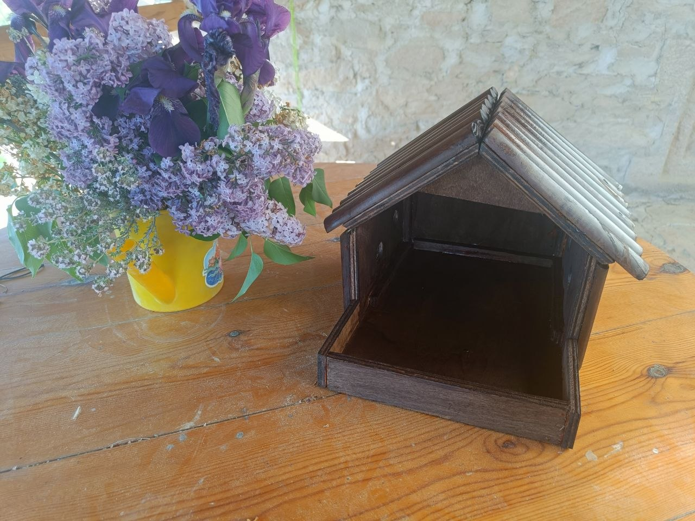

# Jardi-d-Ocells---Birdgarden-2.0
Iniciativa educativa que combina la passió per la natura (en particular els ocells) amb el potencial de la tecnologia

  

Realitzat per [Jordi Mayné](https://github.com/maynej) des de Mechatronic Study jordi.mayne@mechatronicstudy.com 

La documentació està [en PDF](https://github.com/maynej/Jardi-d-Ocells---Birdgarden-2.0/tree/main/DOC/). També amb llengua castellana.

 
## Llicència
Creative Commons Attribution-NoComercial-ShareAlike 4.0 International (CC BY-NC-SA 4.0)  

## QR

